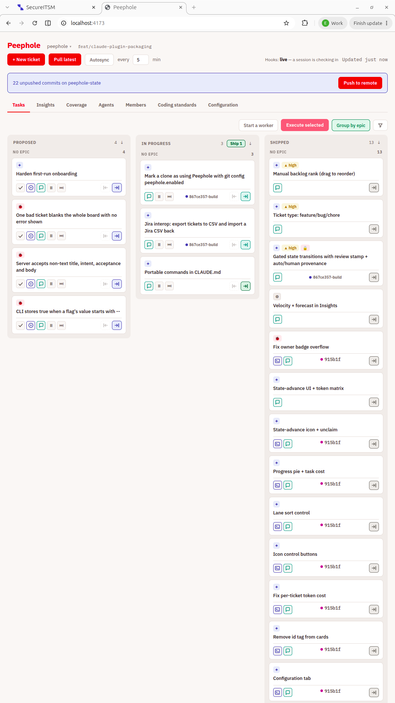
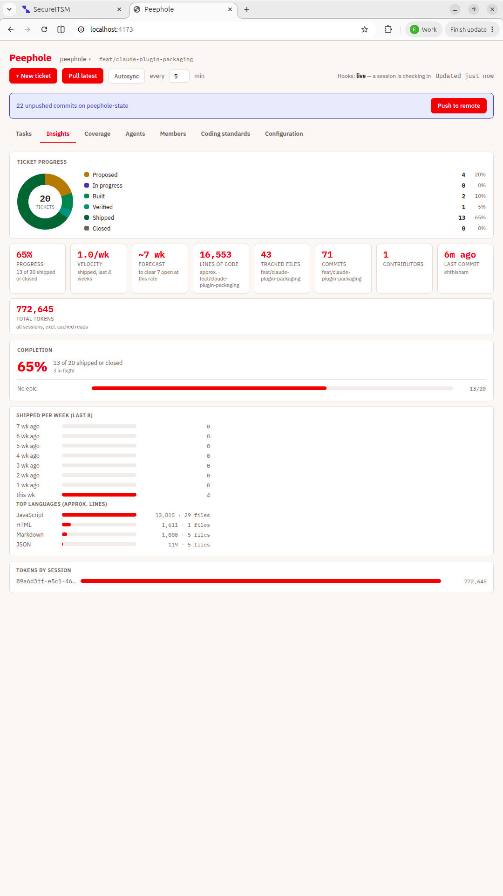
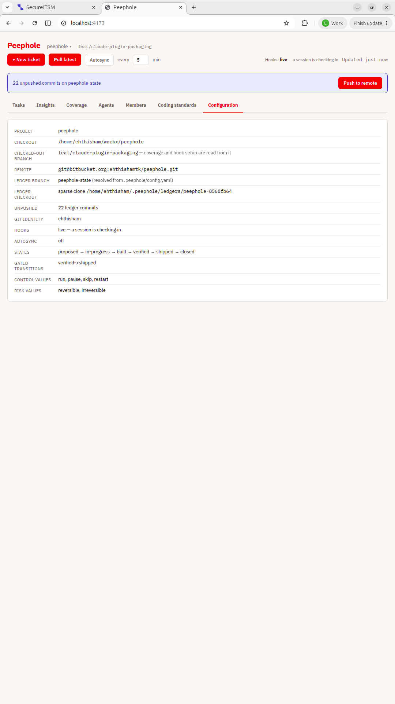
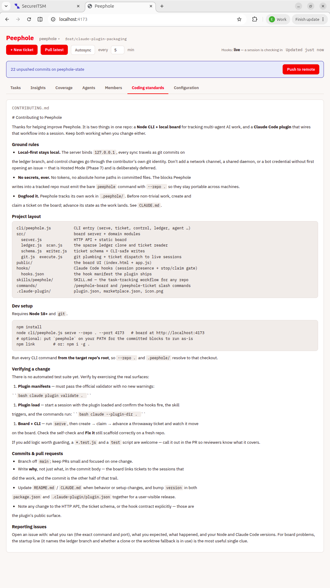

# Peephole — Local Mode

Local-first live status interface into multi-agent AI work. Reads `.peephole/**` straight out of a
git repo (no server, no auth, no bot credential) and writes control changes back through your own
git identity.

## Screenshots

The board — three lanes (proposed → in-progress → closed, with `shipped` an intermediate phase in the
working lane), a search box, cards carrying priority, type, Jira and gate badges, with per-ticket
run/pause/skip and advance controls:



Insights — ticket-progress donut, ship velocity and forecast, shipped-per-week, lines of code and
token spend, all derived from the ledger:



Configuration — how Peephole is wired for this repo, including the gated transitions that require a
review stamp (`verified->shipped` here):



Coding standards — a repo's `CONTRIBUTING.md` rendered right on the board:



## Install as a Claude Code plugin

This repo is also a Claude Code plugin: it ships the ticket-lifecycle **hooks** (session presence +
cooperative stop/claim), a **skill** that carries the task-tracking workflow into any repo, and the
`/peephole-board` and `/peephole-ticket` **slash commands**. The CLI is bundled, so no global
install is needed — hooks and commands invoke it via `${CLAUDE_PLUGIN_ROOT}/cli/peephole.js`.

Add the marketplace, then install (Claude Code 2.1.275+):

```
# GitHub-hosted marketplace (shorthand):
/plugin marketplace add <owner>/<repo>
/plugin install peephole --marketplace <owner>/<repo>

# Any git host (Bitbucket included) or a local clone — add by URL or path:
/plugin marketplace add git@bitbucket.org:ehthishamtk/peephole.git
# or, from a local checkout:
/plugin marketplace add ~/workx/peephole
/plugin install peephole --marketplace peephole
```

To try it without installing, start a session with the plugin loaded directly:

```
claude --plugin-dir ~/workx/peephole
```

## Adding Peephole to a repo

Peephole is a separate checkout that serves any number of repos — nothing is installed into the
repo you are tracking, and the repo gains no dependency on this one. What lands in your repo is
data (`.peephole/`) plus two documentation sections; what stays on your machine is the hook wiring
and a git worktree.

### Install the CLI on your PATH (so the committed blocks work)

The `CLAUDE.md` / `README.md` sections Peephole writes into a tracked repo are **committed and shared**,
so they must not carry one developer's home path. They emit the **bare `peephole` command** with
**`--repo .`** (relative to the repo root), e.g. `peephole serve --repo . --port 4173` — portable on
any machine, provided `peephole` is on your PATH. Install it once from this clone:

```
cd ~/workx/peephole   # (wherever you cloned it)
npm install
npm link              # or: npm i -g .   → puts `peephole` on your PATH
peephole --help
```

Then run every command **from the tracked repo's root**, so `--repo .` and `.peephole/` resolve to
that checkout. (Without a PATH install you can still invoke it as `node <peephole>/cli/peephole.js …`
— but then you're typing the absolute path the committed blocks deliberately avoid.)

### A repo that has never used it

```
cd ~/workx/peephole
node cli/peephole.js serve --repo /path/to/your-repo --port 4173
```

The board opens on a self-check listing what is missing. **Fix it** creates all of it in one local
commit, on the peephole-owned branch inside your repo:

| what | where | committed? |
|---|---|---|
| `config.yaml`, `tickets/`, `agents/` | `.peephole/` in your repo | yes |
| ticket convention for agents | `CLAUDE.md`, between `peephole:start`/`peephole:end` | yes |
| how to open the board | `README.md`, same markers | yes |
| SessionStart / PreToolUse / SessionEnd hooks | `.claude/settings.local.json` | **no — per machine** |
| the working copy writes go through | `.peephole-worktree/` | no — add it to `.gitignore` |

Then click **Push to remote** to share it. Nothing reaches the remote before that.

The hooks are what make the board live: they report each session, enforce pause/skip before every
tool call, and attach token usage. They are written with absolute paths to *this* peephole
checkout, which is why they are per-machine and not committed.

### A repo somebody has already set up

Your teammate's `.peephole/` arrives with a normal `git pull`; the board is not part of it. Get
your own copy of Peephole and point it at the repo:

```
git clone <peephole repo> ~/workx/peephole && cd ~/workx/peephole && npm install
node cli/peephole.js serve --repo /path/to/the-repo --port 4173
```

Every ticket is already there — it is committed repo content. The self-check will still report a
missing hook setup, because `.claude/settings.local.json` is per machine; **Fix it** wires your
own hooks and creates nothing else.

### Notes

- One port per repo — run a second `serve` with `--port 4174` to watch another.
- Requires Node 18+ and a git remote; the board reads the remote's default branch (see
  **Where the files live**).
- The server listens on `127.0.0.1` only. See **Executing tickets** before exposing it.

## Several projects, one board

The project name in the header is a menu. Every repo you have ever served is in it — the list is
built by running the board against a repo, so there is no separate "add project" step, and it is
kept in `~/.peephole/projects.json`, outside every repo it lists (one developer's local paths have
no business travelling to another machine in a git repo).

Switching re-points the whole board: ledger, tickets, coverage, agents, queue. Anything queued for
execution is cancelled first — dispatching it against another repo would run a ticket in the wrong
codebase. A project whose checkout has moved is shown, disabled, rather than hidden.

## Where the ledger is checked out

Peephole keeps its own sparse clone of the repo at `~/.peephole/ledgers/<slug>`, on the ledger
branch, with only `.peephole/` checked out — measured on a real repo: 120 files and 512 KB, against
37 MB for a full worktree. Nothing is added to your repo, and whatever your own checkout is doing
(dirty, mid-rebase, on another branch) is irrelevant to the board.

It falls back to `<repo>/.peephole-worktree` when a clone cannot serve, and the board says which is
in use and why:

- the repo has no remote to clone from
- the ledger branch has never been pushed, so there is nothing to clone yet
- the worktree still holds unpushed ledger commits — switching would show a board missing them

Pushing a ledger branch for the first time moves the ledger out of the repo on the next fetch, with
no restart.

## What Peephole stores, and where

Nothing about a project lives inside the Peephole checkout. Three places hold state, and only one
of them matters if you lose the others.

**In the repo, committed** — `.peephole/` on the ledger branch: `config.yaml`, `tickets/*.md`,
`agents/*.json`. This is the whole board. Everything else can be deleted and rebuilt from it.

**On your machine, disposable** — under `~/.peephole/` (override with `PEEPHOLE_HOME`, and
`PEEPHOLE_LEDGER_HOME` for the clones alone):

```
~/.peephole/
  projects.json                    the menu: which repos this install has served
  ledgers/<repo>-<hash>/           one sparse ledger clone per project
```

`projects.json` is a plain list, written whenever a project is opened:

```json
[
  {
    "id": "hp-platform-api-go",
    "name": "hp-platform-api-go",
    "repoRoot": "/home/you/work/hp-platform-api-go",
    "remoteUrl": "git@bitbucket.org:you/hp-go.git",
    "stateBranch": "peephole-state",
    "lastOpenedAt": "2026-09-16T12:34:33.833Z"
  }
]
```

It is an index, not a source of truth: delete it and you lose the menu, nothing else — opening a
repo again re-adds it. It is kept outside every repo it lists on purpose, since one developer's
local paths have no business travelling to another machine inside a git repo. The clone directory
name carries a hash of the remote so two checkouts that share a folder name never share a ledger.

**In the browser** — the project this tab is showing (`sessionStorage`, so two tabs differ), and
per-viewer preferences in `localStorage`: lane sort, group-by-epic, member and selection filters,
and the last permission mode chosen for a dispatch. None of it reaches the repo or another machine.

**Also per machine, in the repo but never committed** — `.claude/settings.local.json` (the hook
wiring, written by Fix it) and `.peephole-worktree/` when the worktree fallback is in use.

## Moving an existing ledger to its own branch

```
node cli/peephole.js ledger move --repo /path/to/repo --to peephole-state [--push]
```

The target branch is created FROM the current ledger branch, so tickets travel as commits with
their full history, comments and all; the old branch is left exactly as it was, and pointing
`stateBranch` back at it restores the previous board. The command prints the ticket count before
and after and names anything that failed to make the trip. Both branches end up declaring the new
home, so teammates follow automatically once it is pushed.

## Run it (already set up)

```
node cli/peephole.js serve --repo /path/to/your/repo --port 4173
```

Then open http://localhost:4173.

Writes (scaffold, control changes) land in a dedicated worktree at
`<repo>/.peephole-worktree`, on a local branch named `peephole/<stateBranch>` — your own
checkout, branch, and uncommitted changes are never touched. Nothing is pushed to the remote until
you click **Push to remote** and confirm.

## What it does

- **Pull latest** — `git fetch` + re-read, on demand.
- **Autosync** — on a timer (minutes, configurable): pushes the waiting ledger commits, then
  fetches and re-reads. The push happens only if every waiting file is under `.peephole/`; anything
  else and it refuses and says so, since the state branch may be an ordinary code branch and an
  unattended push of somebody's code is not something a toggle should be able to do.
- **Self-check** — flags a missing `config.yaml` / `tickets/` / `agents/` (and a missing
  CLAUDE.md / README.md pointer) as a plain issues list; **Fix it** scaffolds exactly what's
  missing and commits locally.
- **Control** — Run / Pause / Skip per ticket, written to that ticket's `control` field
  and committed locally; every write appends to the ticket's `history`.
- **Claim / assign / unclaim** — a ticket is claimed (by a session id or a person) when work starts
  and moves to in-progress; it can be **assigned** (reserved for a person before anyone claims it),
  and **unclaimed** back to proposed (in-progress only — nothing past it rewinds).
- **Comments & activity timeline** — free-text comments plus a merged, newest-first timeline of every
  state change and comment, each state move carrying a provenance dot (● human / ⚙ auto) and a 🔒 stamp
  where it crossed a gate.
- **“What Claude did” log** — the ticket modal's **Load what Claude did** reads the session transcripts
  for the window the ticket was claimed and replays it as what happened: a line per turn with the tools
  each turn used, subagent (sidechain) turns marked. The durable link from a committed ticket back to
  the ephemeral chat that produced it.
- **Chat about a ticket** — the 💬 on a card opens a Claude session *about* that ticket (via
  `claude attach`) without claiming, queuing or changing anything — because the ticket most worth
  discussing is often one somebody already started.
- **Execute & background workers** — select proposed tickets and hand them to live Claude sessions
  (reusing an idle one, starting a background worker when there's none, queuing while all are busy);
  **attach** a ticket to its own running session. See [Executing tickets](#executing-tickets).
- **Per-ticket cost & durations** — each ticket shows time **waiting** before it was claimed, **work
  duration** once claimed, **tokens spent** (the marginal spend attributable to this ticket's span, not
  the whole session's lifetime), and created / finished timestamps.
- **Epics, tags & filters** — file tickets under an **epic** (and **group by epic** across the lanes),
  add **tags**, and filter the board by member, selection state, tag or epic; **manual backlog rank**
  (drag to reorder), a per-lane **sort** toggle, and **bulk-advance** (e.g. ship every verified ticket
  in one commit).
- **State model** — `proposed → in-progress → built → verified → shipped → closed`. `closed` is the
  only terminal state; `shipped` is an optional intermediate, so a ticket can be **closed after
  shipping**, **closed without shipping** (`verified → closed`), or **closed without developing**
  (abandoned, from any state). State only ever moves forward or to `closed`, never backward.
- **Edit the description after creation** — a ticket's `intent`, `acceptance` and notes (the body) are
  no longer write-once. The modal's **Description → ✎ Edit** saves them back to the ledger (so they
  survive the next CLI op, which a hand-edit would not); also `peephole ticket edit <id>
  [--intent …] [--acceptance …] [--notes …]`.
- **Copy the description** — a **⧉ Copy** button in the modal's Description header puts the ticket's
  intent + acceptance + notes on the clipboard as markdown (each under its own heading), for pasting
  into chat, a PR or Jira. Read-only; falls back to a hidden-textarea copy where the clipboard API is
  refused.
- **Board search** — the Tasks toolbar has a search box that filters the visible cards by **title,
  ticket id, or Jira key** (case-insensitive substring), ANDed with the other filters; Export CSV
  respects it. Escape clears it. A ✕ badge on the filter icon appears whenever any filter *or* the
  search is active — one click clears every filter and the search box at once.
- **Jira issue link** — each ticket has an optional `jira` field (e.g. `PROJ-42`), editable in the
  modal and shown as a badge on the card; set it by hand (`peephole ticket jira <id> --to PROJ-42`)
  or let the Jira push stamp it. When the board knows a Jira base URL the key becomes a direct link.
- **One-way manual push to Jira** (REST) — the ticket modal's **Jira sync** control pushes this ticket
  to Jira Cloud on demand: no `jira` key → **creates** an issue and stamps the key back; has one →
  **updates** it (and falls back to create if the key 404s). It then moves the issue's status
  (best-effort — a transition the Jira workflow won't allow is reported, not fatal) and, if you enter
  worked minutes, logs them to the issue's worklog. One-way only (no pull, no webhooks); a last-synced
  time is stamped on each push. Credentials live **outside** the repo — `~/.peephole/jira.json`
  (`{ baseUrl, email, token, projectKey }`) or `JIRA_BASE_URL` / `JIRA_EMAIL` / `JIRA_TOKEN` /
  `JIRA_PROJECT` — never committed, never in the ledger. Without them the control shows a hint instead
  of a button. If your project marks a custom field **mandatory** on the create screen (a create
  otherwise 400s, e.g. `Task Type is required`), add an optional `extraFields` object to `jira.json`
  (or `JIRA_EXTRA_FIELDS` as JSON) holding raw Jira field shapes — e.g.
  `"extraFields": { "customfield_10032": { "value": "Development" } }` — and Peephole merges it into
  every create/update; look up field ids and allowed values at
  `/rest/api/3/issue/createmeta?projectKeys=PROJ&expand=projects.issuetypes.fields`. Jira v3 bodies
  are ADF; the field map is shared with the CSV interop so the two never drift.
- **Gated transitions + provenance** — every state move records its provenance: `human` (a person
  decided) or `auto` (an agent advanced it with no human in the loop), set with
  `peephole ticket advance <id> --state <s> --mode auto|human` (default `human`). A project can make
  chosen transitions require a review stamp by listing them under `gates:` in `.peephole/config.yaml`:

  ```yaml
  gates:
    - verified->shipped   # moving a ticket into "shipped" from "verified" is stamped
    - shipped             # bare target: ANY move into "shipped" is stamped
  ```

  Crossing a gate records a `gate: true` stamp on the history entry (carrying who, when and the
  mode); the board shows a 🔒 on the card and a stamped, provenance-dotted trail in the ticket's
  Activity. `gates:` absent or empty means every transition is ungated — advance stays free, exactly
  as before.
- **Tabs beyond the board:**
  - **Insights** — ship velocity and a forecast, shipped-per-week, lines of code, test coverage, and
    token spend across the work.
  - **Members** — the people who have touched the ledger, with per-person token attribution joined from
    the agent heartbeats.
  - **Agents** — reads `.peephole/agents/*.json` heartbeats and shows who is running what, marking a
    session `stale` once its heartbeat goes quiet for 5+ minutes.
  - **Coverage** — detected test-coverage per module, when the repo produces it.
  - **Coding standards** — whatever standards / agent-rules files the checkout carries (the policy
    applied *before* code is written), picked from several candidates.
  - **Configuration** — this board's project, checkout, remote, ledger branch + checkout, git identity,
    hooks, autosync, the state list and any gated transitions.
  - **About** — the running Peephole version, this board's project / checkout / remote, the feature
    summary, and links.
- **One board, several repos** — switch between projects without leaving the page; each keeps its own
  ledger, queue and autosync. See [Several projects, one board](#several-projects-one-board).
- **Jira CSV interop** — move tickets between Peephole and Jira over CSV, no live Jira API.

  **On the board** (Tasks tab toolbar):
  - **Export CSV** — downloads the tickets *currently shown* (after whatever member / tag / epic /
    selection filters are active), not the whole ledger. Filter the board first, then export exactly
    that set.
  - **Import CSV** — pick a Jira-exported `.csv`; it previews the create/update/skip plan (and any
    warnings) for confirmation before writing.

  **From the CLI:**

  ```bash
  peephole ticket export --repo <path> [--out tickets.csv]         # Jira-import-ready CSV (stdout if no --out)
  peephole ticket import --repo <path> --file jira.csv [--dry-run] # create/update tickets from a Jira CSV
  ```

  The CSV carries Jira's own columns — `Issue Type, Summary, Description, Acceptance, Status,
  Priority, Assignee, Epic Link` — plus a `peephole-id` column that makes export→import a stable
  round-trip and the dedup key, so re-importing updates tickets rather than duplicating them (an
  `Issue key` column, or a slug of the Summary, is used when no `peephole-id` is present). `--dry-run`
  prints the create/update/skip plan without writing. Field map: `title`↔Summary, `intent`↔Description,
  `acceptance`↔Acceptance, `state`↔Status, `priority`↔Priority, `type`↔Issue Type, `epic`↔Epic Link.
  An unknown Status/Priority/Issue Type falls back to the Peephole default with a warning, never a
  hard fail. State mapping is lossy by nature — Jira has fewer stages, so `built` and `in-progress`
  both export as "In Progress" and import back as `in-progress`. `shipped`↔"Done" and `closed`↔"Closed"
  are kept distinct so both round-trip to themselves.

## Opting a clone in (`peephole.enabled`)

Peephole leaves one stable, plugin-independent signal in each developer's clone that a repo's git
hooks and CI scripts can rely on:

```bash
git config --local --get peephole.enabled   # -> "true"
```

- **`true`** — this developer tracks their work on the Peephole board and accepts ticket-reference
  checks (e.g. a `commit-msg` hook that requires a ticket id in the message).
- **`false`** — this developer has opted out; Peephole will **never** flip it back.
- **unset** — undecided; Peephole sets it to `true` the first time it runs in the checkout.

It is written `--local` (lives in `.git/config`, never committed), so it marks **you**, not your
teammates — a repo where some people use Peephole and some don't can require a ticket reference only
from those who opted in. `peephole serve --repo <path>` and the plugin's SessionStart hook set it
when unset; the board's own ledger checkouts (the sparse clone under `~/.peephole/ledgers`, or a
`.peephole-worktree`) are never marked. Opt in or out explicitly at any time:

```bash
peephole enable  [--repo <path>]   # git config --local peephole.enabled true
peephole disable [--repo <path>]   # opt out; serve/SessionStart won't re-enable it
```

A commit hook can gate on it like this (only enabled developers are checked):

```bash
[ "$(git config --local --get peephole.enabled)" = "true" ] || exit 0
# ...require a ticket reference here...
```

## Executing tickets

Select proposed tickets with the ✓ on their card, then **Execute** one (▷) or the whole selection
from the toolbar. Peephole hands each ticket to a live Claude session in the repo — resuming an
idle one where possible, starting a background session only when the repo has none, and holding
the queue while every session is busy. The ticket is claimed and moved to in-progress at dispatch.

Each dispatch asks which permission mode the agent runs with. `plan` and `acceptEdits` are always
available. `bypassPermissions` — an agent that may run **any** tool, unattended, in your repo — is
refused unless the server was started with `PEEPHOLE_ALLOW_BYPASS=1`.

The server listens on `127.0.0.1` only. Every endpoint is unauthenticated and they create tickets,
push branches and start agents, so exposing the port means handing all of that to anyone who can
reach it; `--host 0.0.0.0` exists but prints a warning, and turning it on together with
`PEEPHOLE_ALLOW_BYPASS=1` is remote code execution by design.

## Where the files live

Two directories with the same name, in the repo being watched — they are the same tracked path
seen from two checkouts:

- `<repo>/.peephole/` — your own branch's copy of the ticket files. Tracked and committed like any
  other source. The board never reads it; it is whatever reached your branch the last time these
  files were merged into it, so it is normally behind.
- `<repo>/.peephole-worktree/` — a git worktree (a second checkout of the same repo, sharing its
  one `.git` object store) permanently on the branch `peephole/<stateBranch>`. Every ticket write
  happens here, which is why your own checkout, branch and uncommitted changes are never touched.
  Its `.peephole/` is the live one the board reads.

Your branch catches up only after **Push to remote** and a pull — until then the board is ahead of
your `<repo>/.peephole/`.

Add `.peephole-worktree/` to the watched repo's `.gitignore`. Git does not ignore a nested worktree
on its own, so it shows up as untracked and one `git add -A` would commit the whole duplicate tree.

### Which branch the ledger lives on

A fresh setup puts the ledger on its own branch, **`peephole-state`**, created from the remote's
default on the first write and shared on the first push. A dedicated branch keeps ticket commits
out of the code history and gives a team one obvious place for them, so nobody starts a second
ledger on a branch of their own. (Not simply `peephole`: the worktree's local branch is
`peephole/<stateBranch>`, and git cannot hold both `refs/heads/peephole` and `refs/heads/peephole/…`.)

Resolved in this order: `--branch` on the command line, then `stateBranch` in the repo's committed
`.peephole/config.yaml`, then an existing `peephole-state` branch on the remote, then a new one.
A repo set up before this — whose config names a code branch — keeps reading that branch.

Declare it in `config.yaml` and keep it generic — `main`, or a dedicated `peephole` branch. The
last resort is whatever a git host happens to report as default, which is not necessarily stable: a
repo whose default is set to a feature branch pins the entire ticket ledger to that branch, and
when it merges and is deleted the tickets leave the default line with it. It is also per-machine —
if `git remote show` fails (offline, no auth) each machine falls back to its own checked-out branch
and quietly reads a different board. A board resolved that way says so in the startup line and
marks the branch in the header.

Changing `stateBranch` later points the board at a different branch; it does not move the tickets.
Merge or cherry-pick `.peephole/` onto the new branch first, or the board opens empty.

## Removing it from a repo

Stop the server first (the worktree is in use while it runs), then, in the watched repo:

```
git worktree remove --force .peephole-worktree     # the checkout AND its registration
git branch -D peephole/<stateBranch>               # the local state branch (e.g. peephole/main)
```

Deleting the folder by hand is not enough — the registration lives in `.git/worktrees/`, and git
will keep reporting a broken worktree until `git worktree remove` (or `git worktree prune`) clears
it.

That leaves the ticket data itself, which is ordinary tracked content. To remove that too:

```
git rm -r .peephole && git commit -m "Remove Peephole ticket data"
git push origin <stateBranch>                      # if the branch was already shared
git push origin --delete peephole/<stateBranch>    # only if that branch was ever pushed
```

Finally, unwire the per-machine bits, none of which are in the repo's history:

- `.claude/settings.local.json` — drop the hook entries pointing at `peephole/hooks/`.
- `CLAUDE.md` and `README.md` — delete the `<!-- peephole:start v=2 -->
## Task board (Peephole)

This repo's AI-executed work is tracked live in `.peephole/`. To see current status — what's
in progress, blocked, shipped — run:

```
peephole serve --repo . --port 4173
```

then open the printed `http://localhost:<port>` link.

### The two `.peephole` directories

Both are the same tracked path, seen from two checkouts of this repo:

- `.peephole/` — this branch's copy of the ticket files, committed like any other source. The
  board never reads it, so it is normally behind: it is whatever reached this branch the last time
  the ticket files were merged in.
- `.peephole-worktree/` — a git worktree (a second checkout sharing this repo's one `.git`
  object store) parked on the branch `peephole/<stateBranch>`. Every ticket write happens there,
  which is why your own branch and uncommitted changes are never touched. Its `.peephole/` is the
  live one the board reads.

This branch catches up only after the board's **Push to remote** and a pull.

Keep `.peephole-worktree/` in `.gitignore` — git does not ignore a nested worktree on its own,
so it shows as untracked and one `git add -A` would commit the whole duplicate tree.

### Removing Peephole from this repo

Stop the board first (the worktree is in use while it runs), then:

```
git worktree remove --force .peephole-worktree     # the checkout AND its registration
git branch -D peephole/<stateBranch>               # the local state branch
```

Deleting the folder by hand is not enough — the registration lives in `.git/worktrees/`, and git
keeps reporting a broken worktree until `git worktree remove` (or `git worktree prune`) clears it.

The ticket data is ordinary tracked content; to drop that too:

```
git rm -r .peephole && git commit -m "Remove Peephole ticket data"
git push origin <stateBranch>                      # if the branch was already shared
git push origin --delete peephole/<stateBranch>    # only if that branch was ever pushed
```

Then unwire the per-machine bits, which are not in git history: the `peephole/hooks/` entries in
`.claude/settings.local.json`, and the `peephole:start`/`peephole:end` sections in this file
and in CLAUDE.md.
<!-- peephole:end -->
`
  sections the scaffold added.

Peephole's own checkout is untouched by all of this: it stores nothing about the repos it watches.

## Sync is git, and only git

Everything a board knows travels as commits on the ledger branch. There is no live channel between
two people's boards, and that is a decision rather than a gap: each developer runs their own board
against their own checkout, and the hooks only ever talk to `localhost`.

What that means in practice:

- Pausing or skipping a ticket reaches a teammate's agent after a push and their fetch — turn on
  **Autosync** and that is one interval, not whenever somebody remembers to press a button.
- A board only enforces `control` on sessions running on its own machine. Nobody can stop your
  agent from their laptop, and nothing can stop a colleague's agent from yours.
- Nothing listens on the network. The server binds `127.0.0.1`, and the check-in endpoint that
  gates every tool call is not reachable from another machine — which is also why there is no
  shared-board authentication to get wrong.

A shared always-on instance with auth (Hosted Mode, Phase 7) would change all three. It stays
deferred.

## Not yet built

- Bitbucket branch/PR/CI/deploy enrichment (Phase 5).

## Contributing

See [CONTRIBUTING.md](CONTRIBUTING.md) — dev setup, the project layout, how to verify a change
(`claude plugin validate .` and a live `--plugin-dir` load), and commit conventions. Peephole
tracks its own work on its board, so start by claiming a ticket.

## License

[MIT](LICENSE) © ehthisham
